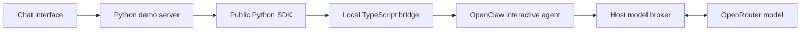

# Memory Chat — SDK Connection

Memory Chat is a consumer of the installed public `openclaw_memory_bridge` package. It does not import the bridge's TypeScript implementation or native OpenClaw internals.

## Request path



The production server uses `NativeChatDemo`. The browser submits a message to the host, which calls the public SDK's native chat operation. OpenClaw owns the model/tool loop and authoritative session history. The Python host retains UI records, operation evidence, cancellation state, and the estimated provider allowance. It does not reconstruct new-session context by copying old messages into a model prompt.

Opening the page constructs neither the SDK connection nor a model request. The first native operation connects lazily. Unlike the earlier independent model/tool demo, a native chat turn requires the Gateway.

## Public SDK wiring

```python
from pathlib import Path
from openclaw_memory_bridge import BridgeConfig, MemoryClient, MemoryScope

config = BridgeConfig(
    foundation=Path("/path/to/openclaw-memory-bridge"),
    root=Path("/path/to/app-data/memory"),
)
scope = MemoryScope("memory-chat", "demo", "conversation-one")

with MemoryClient(config) as memory:
    # This endpoint belongs to the host and enforces its model allowance.
    memory.configure_chat(scope, model_url=model_url)
    receipt = memory.chat(scope, "I drink my coffee without sugar.")
    memory.index(scope)
    next_scope = MemoryScope("memory-chat", "demo", "conversation-two")
    recall = memory.chat(next_scope, "How do I take my coffee?")
```

This fragment requires a running host-owned OpenAI-compatible loopback model endpoint. The demo supplies it with `NativeProviderBroker` in [native_provider.py](native_provider.py). `configure_chat` binds its URL for the lifetime of that SDK process; a new client must bind again. The transient URL is not a reusable saved model setting. `foundation` points to the local bridge runtime and `root` holds persistent data. The Python wheel does not include Node/OpenClaw.

`chat` uses the public native `chat.send` operation, awaits the exact run's completion, then returns admission, completion, history, and session-state receipts. It enters a persistent interactive session rather than injecting a synthetic transcript. Workspace and user select the corpus; the session identifier selects conversation context. The native profile enables transcript indexing and cross-conversation Active Memory, allows native recall and source-reading tools, and retains normal pre-compaction flushing. Automatic dreaming and background model scheduling remain disabled in this demo.

The production host uses the equivalent `start_chat`, `wait_chat`, and `abort_chat` operations so it can check Stop between bounded polls and cancel the exact native run. The broker also withholds a late model response when Stop arrives during inference, so that response cannot start a subsequent native tool call. Already-dispatched model attempts remain recorded; a validated successful response with a returned provider cost can settle its estimate even when Stop prevents further native work.

The earlier `ChatDemo` class and `MemoryTools` adapter remain an independent-host reference and controlled-test path. They are not the production UI's chat implementation. `MemoryTools` still supports search, source reads, canonical note replacement, and daily-note replacement, with indexing after writes; using those tools alone does not transfer an external model history into native session management.

## Conversation ordering and persistence

Native user and assistant messages belong to the OpenClaw session. A second message in the same chat uses that native history. A new session uses the same workspace/user corpus without inheriting the prior session's current model context.

Native transcript indexing is normally asynchronous. Before **New chat** or restart creates fresh context, the demo waits for the public `index` operation, which runs the official native index command. The operation remains busy until this recall-preparation barrier succeeds. A failure is not labelled as successful indexing or fresh-session readiness. This explicit barrier can take time; cached polling and Stop remain available.

Restart preserves notes, transcripts, indexes, UI records, and cumulative request/reservation counters. The SDK connection is recreated and its current broker URL rebound when needed. Starting a new conversation does not erase the previous native session.

Transcript persistence, retrieval readiness, and curated fact storage are distinct outcomes. OpenClaw can retrieve a past conversation without creating a preference note for every sentence. Native agent writes and flushing follow their supported policy; neither a model answer nor a transcript receipt proves automatic fact supersession or completed dreaming.

## Provider allowance and credentials

The real API key stays in the Python provider adapter. OpenClaw receives only a host-owned loopback endpoint. Every admitted native main-agent, recall-agent, and flush model request passes through the same `Provider` instance and durable allowance used by the demo. The broker forwards genuine results in the OpenAI-compatible response format; it does not generate replacement answers.

A chat operation opens a bounded broker admission window. Outside it, completion requests are rejected. A provider failure closes the window against further completion attempts for that operation. Each dispatch first reserves a conservative estimate. New validated successful replies with a returned provider cost settle their own estimates; failed or uncertain attempts, missing costs, and earlier-version reservations remain fully committed. Settlement never decreases the historical request or reservation counters. Restart, new conversation, and Stop do not reset this accounting. The local allowance is neither an invoice nor a provider billing hard cap.

The demo's `--budget-usd N` flag sets a total local ceiling. To increase an existing ceiling, stop its server and restart with the same data root and a higher value; for the default root, use `npm run chat -- --budget-usd 10`. This authorizes a total of 10 USD including prior committed usage, not an additional 10 USD. The original admission, request history, counters, and memory are retained. Restarting at the same ceiling adds no allowance; a lower ceiling or a different model/output/pricing policy is rejected. This policy belongs to the demo host rather than the public SDK.

## Responsive requests and evidence

`GET /api/state` returns cached state only. Chat, walkthrough, memory refresh, new-conversation preparation, and restart run as asynchronous jobs. The browser polls for progress; `POST /api/cancel` requests Stop without waiting on a model or SDK call. Drafting a message does not dispatch it while another operation is active.

The inspector and export show recorded native outcomes and observed source excerpts. Available/stale state is explicit. A displayed SHA-256 identifies the returned excerpt rather than a forensic hash of an entire native file. The host does not inspect SQLite or scan native storage to manufacture evidence. Provider-internal reasoning is excluded from public activity and exports.

`NativeChatDemo.chat`, `new_conversation`, `restart_memory`, `state`, and `export` in [server.py](server.py) are the production integration points. The optional walkthrough uses those same methods. `ReplayDemo` displays a saved capture without constructing an SDK client or provider and does not rerun its operations.

## Responsibilities and limits

| Layer | Owns |
| --- | --- |
| Browser | Chat display, inspector, controls, capture download |
| Demo host | HTTP jobs, UI records, cancellation, event capture, model broker and estimated allowance |
| Python SDK | Scoped native chat and memory operations, bridge protocol, child-process connection |
| OpenClaw | Authoritative conversation history, model/tool loop, recall, memory files, indexes and native session maintenance |

Scope routing is not authentication. This is one trusted local process per data root, not a multi-tenant service. Native automatic old-fact supersession remains unsupported through the pinned ingestion path. Normal conversation retention does not guarantee every utterance becomes an immediately curated permanent fact. Independent Python model loops still own their external histories unless they explicitly use the native chat path.
