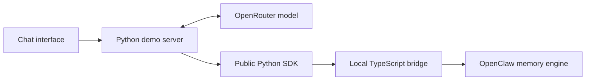

# Memory Chat — SDK Connection

Memory Chat is a consumer application. Its backend imports the installed public `openclaw_memory_bridge` package; it does not import the bridge's TypeScript implementation or native OpenClaw internals.

## Request path



The browser sends messages to the local demo server, which owns the model/tool loop. Credentials stay there. The live server imports the public SDK classes at startup but creates no `MemoryClient`, starts no Gateway, and reads no source. Ordinary model chat does not depend on Gateway readiness.

## Public SDK surface

When a memory operation is needed, the connection uses this public API wiring:

```python
from pathlib import Path
from openclaw_memory_bridge import (
    BridgeConfig,
    MemoryClient,
    MemoryScope,
    MemoryTools,
)

config = BridgeConfig(
    foundation=Path("/path/to/openclaw-memory-bridge"),
    root=Path("/path/to/app-data/memory"),
)
memory = MemoryClient(config)
scope = MemoryScope("memory-chat", "demo", "conversation-one")
tools = MemoryTools(memory, scope, "2026-11-03")
```

This is an illustrative direct-wiring fragment. The running [server](server.py) stores a client factory in `ChatDemo` and calls it lazily in `_get_memory`, through `_MemoryAccess`, only for a real memory tool, explicit refresh, or restart. It uses workspace `memory-chat`, user `demo`, and the current source date/conversation identifier. `foundation` points to the local bridge runtime; `root` holds persistent application data. The Python wheel does not contain Node/OpenClaw.

The host passes `tools.definitions` to the genuine model. For each returned tool call it parses the JSON arguments and invokes:

```python
result = tools.execute(tool_name, arguments)
```

The host appends that actual result as a tool message before requesting the model's next response.

The adapter tools are `memory_search`, `memory_get`, `memory_save`, and `memory_save_daily`. Writes also call the SDK's `index` operation. Before replacing a known write target, the host reads its actual source through the SDK. An indexing failure can leave a saved source in place; it is reported as a failed tool operation, not silently rolled back or confirmed successful.

The SDK owns validated bridge requests and the local process connection. OpenClaw owns the indexes, retrieval, source reads, and native maintenance behavior. The demo supplies no alternative ranking or memory-storage algorithm.

## Conversation and persistence

The selected workspace and user stay stable when the operator starts a new conversation. The host creates empty model history and a new session identifier, while reusing the same memory data root. This separates fresh-conversation recall from remembering text that remains in the model's message history. Existing data is not silently cleared when the guided flow starts.

The restart control restarts the selected native Gateway, closes the SDK client, and opens a fresh host conversation. A new SDK connection is created lazily when needed on the same persisted root. Notes, indexes, and provider request records are not removed.

The inspector remembers source paths from public tool results and reads them through `memory.get(scope, path, lines=200)`. Explicit refresh also checks the adapter's known preference/today targets. It does not scan native workspaces, inspect SQLite, or import private engine modules. Discovering a source through a read does not count as creating it; changes are reported only for attempted write targets with verified before/after excerpts.

Before/after changes compare the actual text returned by those public SDK reads. The displayed SHA-256 identifies that returned excerpt, not a forensic hash of an entire native file. Demo notes are bounded so their short content fits within the read. Native files that have never been observed through the public tools are not advertised as a complete filesystem inventory.

SDK write/search/get results and model/tool events explain what actually executed. A successful-sounding assistant message alone is not a storage receipt. Exported evidence comes from the actual session; sample prompt text in the README is not recorded model output.

Provider-internal reasoning metadata is retained only in private model history when needed for tool-call continuation. It is excluded from browser activity and exported model responses. Source and user text are preserved so the displayed excerpt digest and diff describe the same text.

## Responsive requests and failures

`GET /api/state` returns cached state only. Chat, walkthrough, memory refresh, and restart requests return HTTP 202 with a job; the browser polls that cached state for progress. `POST /api/memory/refresh` performs explicit source reads in the worker. `POST /api/cancel` requests Stop without blocking the page on the running model or SDK operation.

The host checks cancellation before each subsequent dispatch. An in-flight request can finish, and its reservation is not refunded. Known provider failures restore the private unfinished model history while retaining the visible failed turn; another explicit message can use the same conversation. An uncertain write acknowledgement blocks that conversation until New chat. Interrupted blocked conversations open a fresh host conversation on application startup without clearing data or ledgers.

Memory failures are returned to the model as failed tool results. A completed genuine model answer is retained if memory or the final source snapshot fails; source panels are marked unavailable/stale and unverified changes are omitted. Partial output-limit responses carry a notice and are not continued automatically.

`ChatDemo.chat`, `new_conversation`, `restart_memory`, `state`, and `export` are the main integration points in [server.py](server.py). The optional `tour_next` uses the same chat/backend methods: save Atlas/Friday, update to Nova, empty-conversation recall, restart and recall, then capture export readiness.

`ReplayDemo` loads an exported capture for read-only viewing. The SDK imports occur only inside `ChatDemo`, so replay constructs neither a `MemoryClient` nor a `Provider`. It displays recorded results rather than executing the model loop again. The UI clearly identifies replay mode and disables operations that could write memory or spend the live allowance.

## Responsibilities and limits

| Layer | Owns |
| --- | --- |
| Browser | Chat display, inspector, controls, export download |
| Demo host | Model requests, conversation history, tool dispatch, local server, event capture, estimated request allowance |
| Python SDK | Scoped memory operations, bridge protocol, child-process connection |
| OpenClaw | Native source retrieval, indexes, persistence, and supported maintenance |

The host chooses trusted scopes; routing is not authentication. Native session flush and compaction do not manage this external Python message history. Replacing the preference source is an explicit application write, not proof of automatic old-fact supersession. The demo does not schedule automatic dreaming or claim production multi-worker isolation.
