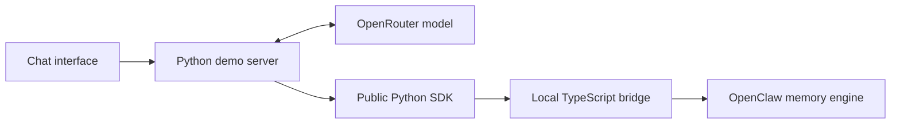

# Memory Chat — SDK Connection

Memory Chat is a consumer application. Its backend imports the installed public `openclaw_memory_bridge` package; it does not import the bridge's TypeScript implementation or native OpenClaw internals.

## Request path



The browser sends messages to the local demo server. The server owns the model/tool loop. Model-request credentials remain on that server. A model memory-tool call is executed through `MemoryTools`, which delegates to the installed SDK; the model receives the actual result before producing its final reply.

## Public SDK surface

The connection uses these imports:

```python
from pathlib import Path
from openclaw_memory_bridge import (
    BridgeConfig,
    MemoryClient,
    MemoryScope,
    MemoryTools,
)

config = BridgeConfig(
    foundation=Path("/path/to/openclaw-memory-bridge"),
    root=Path("/path/to/app-data/memory"),
)
memory = MemoryClient(config)
scope = MemoryScope("memory-chat", "demo", "conversation-one")
tools = MemoryTools(memory, scope, "2026-11-03")
```

This is an illustrative wiring example. The running [server](server.py) creates its client in `ChatDemo`, uses workspace `memory-chat` and user `demo`, and supplies its selected paths, current source date, and conversation identifier. `foundation` points to the installed local bridge runtime. `root` points to persistent application-owned data. The Python wheel contains the client, not the Node/OpenClaw runtime.

The host passes `tools.definitions` to the genuine model. For each returned tool call it parses the JSON arguments and invokes:

```python
result = tools.execute(tool_name, arguments)
```

The supported adapter tools are `memory_search`, `memory_get`, `memory_save`, and `memory_save_daily`. Preference and daily-note writes automatically call the SDK's `index` operation. An indexing failure is reported as a failure even if the preceding source write already succeeded; the inspector can show that partial result.

The SDK owns validated bridge requests and the local process connection. OpenClaw owns the indexes, retrieval, source reads, and native maintenance behavior. The demo supplies no alternative ranking or memory-storage algorithm.

## Conversation and persistence

The selected workspace and user stay stable when the operator starts a new conversation. The host creates empty model history and a new session identifier, while reusing the same memory data root. This separates fresh-conversation recall from remembering text that remains in the model's message history. Existing data is not silently cleared when the guided flow starts.

The restart control restarts the selected native Gateway, closes the SDK client, and opens a new client on the same persisted root. It does not remove notes, indexes, or the provider request ledger.

The memory inspector remembers source paths from public tool results and pre-reads the adapter's known preference/today write targets before a turn. It reads sources through `memory.get(scope, path, lines=200)`. It does not scan OpenClaw's workspace, inspect SQLite, or import private engine modules. Discovering an existing source through a read does not count as creating it; changes are reported only for attempted write targets with their actual before/after excerpts.

Before/after changes compare the actual text returned by those public SDK reads. The displayed SHA-256 identifies that returned excerpt, not a forensic hash of an entire native file. Demo notes are bounded so their short content fits within the read. Native files that have never been observed through the public tools are not advertised as a complete filesystem inventory.

SDK write/search/get results and model/tool events explain what actually executed. A successful-sounding assistant message alone is not a storage receipt. Exported evidence comes from the actual session; sample prompt text in the README is not recorded model output.

Provider-internal reasoning metadata is retained only in private model history when needed for tool-call continuation. It is excluded from browser activity and exported model responses. Source and user text are preserved so the displayed excerpt digest and diff describe the same text.

The backend's main integration points are `ChatDemo.chat`, `new_conversation`, `restart_memory`, `state`, and `export` in [server.py](server.py). `chat` returns the model's final reply; the HTTP endpoint returns the resulting UI state. `tour_next` exercises the same methods as free chat rather than an alternate scripted memory implementation: save Atlas/Friday, update to Nova while preserving Friday, recall in an empty conversation, restart and recall again, then mark the capture ready for export.

`ReplayDemo` loads an exported capture for read-only viewing. The SDK imports occur only inside `ChatDemo`, so replay constructs neither a `MemoryClient` nor a `Provider`. It displays recorded results rather than executing the model loop again. The UI clearly identifies replay mode and disables operations that could write memory or spend the live allowance.

## Responsibilities and limits

| Layer | Owns |
| --- | --- |
| Browser | Chat display, inspector, controls, export download |
| Demo host | Model requests, conversation history, tool dispatch, local server, event capture, estimated request allowance |
| Python SDK | Scoped memory operations, bridge protocol, child-process connection |
| OpenClaw | Native source retrieval, indexes, persistence, and supported maintenance |

The host chooses trusted scopes; routing is not authentication. Native session flush and compaction do not manage this external Python message history. Replacing the preference source is an explicit application write, not proof of automatic old-fact supersession. The demo does not schedule automatic dreaming or claim production multi-worker isolation.
